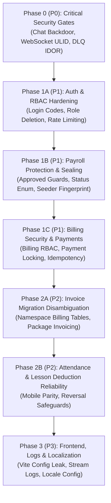

# Comprehensive Remediation & Implementation Plan

This implementation plan details the exact, step-by-step technical remediation for all verified vulnerabilities, data integrity risks, architectural flaws, and configuration issues in the **Management-system-core** codebase.

---

## 1. Baseline Test Suite & Verification Status

### Initial Baseline (Prior to Remediation)
Prior to any code modifications, the full backend test suite was executed in the test environment (`sqlite` in-memory):
- **Total Tests**: 214
- **Passed**: 212
- **Skipped**: 1 ([InvoiceControllerTest.php:L19](file:///c:/Users/a.awad/Desktop/NH/Management-system-core/tests/Feature/InvoiceControllerTest.php#L19) - skipped due to the table collision)
- **Failed**: 1 ([LocalizationTest.php:L76](file:///c:/Users/a.awad/Desktop/NH/Management-system-core/tests/Feature/Core/LocalizationTest.php#L76) - default application locale returns `'en'` instead of `'de'`)

### Latest Verification Status (Post-Phase 1B Steps 1–5)
Steps 1–4 of the Phase 1B payroll and deletion-protection remediation have passed the available targeted automated verification in the single-process SQLite test environment. **Note:** Passing these automated suites does not establish that every production-database or multi-connection concurrency scenario has been verified, nor is the entire repository test suite fully passing yet.

- **Latest Targeted Payroll, Security, Lesson, Teacher & PDF Report Verification (`Phase1BSecurityTest`, `PayrollCalculationServiceTest`, `PayrollGeneratorServiceTest`, `GeneratorIdempotencyTest`, `FinancialUpdateTest`, `LessonControllerTest`, `LessonCancellationTest`, `TeacherControllerTest`, `PdfReportServiceTest`, `DomainLogicTest`)**:
  - **Passed**: 88 (`73` across the 6 payroll/security/PDF suites + `15` across the lesson/teacher/unit suites)
  - **Failed**: 0
  - **Skipped**: 0
  - **Assertions**: 388 (`331` across the 6 payroll/security/PDF suites)
- **Latest Full Repository Test Suite (`php artisan test --no-ansi`)**:
  - **Passed**: 290
  - **Failed**: 1 ([LocalizationTest.php:L76](file:///c:/Users/a.awad/Desktop/NH/Management-system-core/tests/Feature/Core/LocalizationTest.php#L76) - pre-existing default locale issue outside payroll scope)
  - **Skipped**: 1 ([InvoiceControllerTest.php:L19](file:///c:/Users/a.awad/Desktop/NH/Management-system-core/tests/Feature/InvoiceControllerTest.php#L19) - pre-existing `invoices` table collision outside payroll scope)
  - **Assertions**: 1,301

All phases below are designed to maintain 100% pass rate on passing tests, fix the existing localization failure (Phase 3), unskip and pass the billing invoice test (Phase 2A), and introduce exhaustive negative regression tests.

---

## 2. Phase-by-Phase Remediation Plan



---

### Phase 0: Critical Security Vulnerabilities (P0)

#### [P0-01] Chat Unauthorized Channel Membership via `markRead` Backdoor & IDOR
- **Severity**: Critical (CVSS 9.1)
- **Root Cause**:
  In [TeacherChatController.php:L158-L161](file:///c:/Users/a.awad/Desktop/NH/Management-system-core/app/Modules/Nachhilfe/Presentation/Controllers/TeacherChatController.php#L158-L161) and [StudentChatController.php:L113-L116](file:///c:/Users/a.awad/Desktop/NH/Management-system-core/app/Modules/Nachhilfe/Presentation/Controllers/StudentChatController.php#L113-L116), `markRead` executes `ChatParticipant::firstOrCreate([...], ['role' => 'member', ...])`. In [ChatController.php:L196-L199](file:///c:/Users/a.awad/Desktop/NH/Management-system-core/app/Modules/Nachhilfe/Presentation/Controllers/ChatController.php#L196-L199), it assigns `['role' => 'observer', ...]`.
- **Actual Impact**:
  Any student or teacher can submit a `POST` request to `.../chat/channels/{any_id}/read` and automatically enroll themselves as an active `member` in any private channel. Once enrolled, the user can read all past messages, post new messages, access surveys, download private attachments, and subscribe to real-time WebSocket events.
- **Exact Files Likely to Change**:
  - `app/Modules/Nachhilfe/Presentation/Controllers/ChatController.php`
  - `app/Modules/Nachhilfe/Presentation/Controllers/TeacherChatController.php`
  - `app/Modules/Nachhilfe/Presentation/Controllers/StudentChatController.php`
  - `routes/api.php`
- **Proposed Fix**:
  1. In `TeacherChatController` and `StudentChatController`, change `firstOrCreate` to:
     ```php
     $participant = ChatParticipant::where('channel_id', $id)
         ->where('user_id', $request->user()->id)
         ->first();
     abort_unless($participant, 403, 'Unauthorized: You are not a participant in this channel.');
     $participant->update(['last_read_at' => now()]);
     ```
  2. In `ChatController::markRead`, restrict to users who are already participants or authorized observers (`Super Admin`, `Admin`, `Center Manager`).
  3. In `ChatController::indexMessages`, `destroyMessage`, `destroyChannel`, and `downloadAttachment`, enforce channel participation or administrative role verification before executing.
  4. In `routes/api.php`, apply `role:Super Admin|Admin|Center Manager` to administrative channel routes `/nachhilfe/chat/channels` (excluding teacher/student mobile endpoints).
- **Regression Tests Required**:
  - `test_non_participant_student_cannot_join_channel_via_mark_read` (assert HTTP 403, participant count unchanged).
  - `test_teacher_cannot_mark_read_or_access_foreign_channel` (assert HTTP 403).
  - `test_unauthorized_user_cannot_download_attachment_or_delete_message` (assert HTTP 403).
- **Dependencies & Risks**: None. Pure authorization logic; completely backward-compatible with legitimate users.

---

#### [P0-02] WebSocket Private Channel Authorization ULID Integer Truncation
- **Severity**: Critical (CVSS 8.8)
- **Root Cause**:
  In [routes/channels.php:L6-L8](file:///c:/Users/a.awad/Desktop/NH/Management-system-core/routes/channels.php#L6-L8), the user private channel authorization is defined as:
  ```php
  Broadcast::channel('App.Models.User.{id}', function ($user, $id) {
      return (int) $user->id === (int) $id;
  });
  ```
- **Actual Impact**:
  All user IDs are 26-character string ULIDs. In PHP, casting string ULIDs starting with `01` to `(int)` evaluates to integer `1`. Any user whose ULID starts with `01` can subscribe to the private WebSocket channel of any other user whose ULID also starts with `01`, eavesdropping on private notifications and direct events.
- **Exact Files Likely to Change**:
  - `routes/channels.php`
- **Proposed Fix**:
  Replace integer casting with strict string comparison:
  ```php
  Broadcast::channel('App.Models.User.{id}', function ($user, string $id) {
      return (string) $user->id === (string) $id;
  });
  ```
- **Regression Tests Required**:
  - Unit test verifying string ULID equality where two distinct ULIDs sharing prefix `01` evaluate to false.
  - Broadcast authorization feature test asserting user A cannot authenticate for channel `App.Models.User.{userB_id}`.
- **Dependencies & Risks**: None. String comparison is strictly more correct.

---

#### [P0-03] Unprotected Universal Notification Outbox & DLQ Administration
- **Severity**: High (CVSS 7.5)
- **Root Cause**:
  In [routes/api.php:L40-L41](file:///c:/Users/a.awad/Desktop/NH/Management-system-core/routes/api.php#L40-L41), `/admin/notifications/outbox` and `/admin/notifications/outbox/{id}/retry` are placed under base `auth:sanctum` without role or permission checks. [AdminNotificationController.php:L16-L75](file:///c:/Users/a.awad/Desktop/NH/Management-system-core/app/Core/Presentation/Controllers/AdminNotificationController.php#L16-L75) does not inspect `$request->user()`.
- **Actual Impact**:
  Any authenticated student or teacher can read all notification outbox payloads (including recipient emails, phone numbers, raw message bodies, and error logs) and trigger retries on failed/dead-letter items.
- **Exact Files Likely to Change**:
  - `app/Core/Presentation/Controllers/AdminNotificationController.php`
  - `routes/api.php`
- **Proposed Fix**:
  Add permission checks:
  ```php
  abort_unless(
      $request->user()?->hasAnyRole(['Super Admin', 'Admin', 'Center Manager']) 
      || $request->user()?->can('manage settings'),
      403,
      'Unauthorized access to notification outbox.'
  );
  ```
- **Regression Tests Required**:
  - `test_student_and_teacher_cannot_access_outbox_or_trigger_retry` (assert HTTP 403).
  - `test_admin_and_center_manager_can_access_outbox_and_retry` (assert HTTP 200).
- **Dependencies & Risks**: None.

---

### Phase 1A: Authentication, Authorization & Privilege Escalation (P1)

#### [P1-01] Privilege Escalation via Login-Code Account Linking & Unsafe GET Mutation
- **Severity**: High (CVSS 8.5)
- **Root Cause**:
  1. [LoginCodeController.php:L69-L120](file:///c:/Users/a.awad/Desktop/NH/Management-system-core/app/Core/Presentation/Controllers/LoginCodeController.php#L69-L120) runs `User::firstOrCreate(['email' => $email])` and `$user->assignRole('Teacher')` / `assignRole('Student')` on a `GET` request **before** caller authorization is verified.
  2. If a student/teacher record is given an administrator's email, `firstOrCreate` binds to the administrative `User` and grants them the `'Student'` or `'Teacher'` role.
  3. [LoginCodeController::loginByCode:L248](file:///c:/Users/a.awad/Desktop/NH/Management-system-core/app/Core/Presentation/Controllers/LoginCodeController.php#L248) checks:
     `if (!$user->hasAnyRole(['Student', 'Teacher'])) return ['status' => 'unauthorized_role'];`
     If an admin also possesses `'Student'` or `'Teacher'`, `loginByCode` succeeds and issues a Sanctum bearer token with unrestricted abilities (`*`), granting full administrative access via an 8-character code.
  4. In `show($userId)`, only `Super Admin` is guarded against non-super admins. A Center Manager can view the login code for an `Admin`.
- **Exact Files Likely to Change**:
  - `app/Core/Presentation/Controllers/LoginCodeController.php`
  - `app/Modules/Nachhilfe/Presentation/Controllers/StudentController.php`
- **Proposed Fix**:
  1. Move caller authorization to the top of `showStudentCode` and `showTeacherCode` before any database queries or mutations occur.
  2. Ensure `User::firstOrCreate` only links accounts if the existing user is strictly a `Student` or `Teacher` and has no administrative roles (`Super Admin`, `Admin`, `Center Manager`, `Receptionist`).
  3. In `loginByCode`, check that the user **only** has client roles:
     ```php
     if ($user->hasAnyRole(['Super Admin', 'Admin', 'Center Manager', 'Receptionist'])) {
         return ['status' => 'unauthorized_role'];
     }
     if (!$user->hasAnyRole(['Student', 'Teacher'])) {
         return ['status' => 'unauthorized_role'];
     }
     ```
  4. In `show($userId)` and `regenerate($userId)`, guard all administrative roles (`Super Admin`, `Admin`, `Center Manager`) so lower-privileged users cannot view or regenerate codes for higher-tier users.
- **Regression Tests Required**:
  - `test_user_with_admin_role_cannot_login_via_mobile_code_even_if_assigned_teacher_role`.
  - `test_unprivileged_user_cannot_trigger_user_creation_via_teacher_login_code_get`.
  - `test_center_manager_cannot_view_or_regenerate_admin_login_code`.
- **Dependencies & Risks**: Backward-compatible with standard student/teacher mobile flows.

---

#### [P1-02] Deletion of Core System Roles in `RoleController::destroy`
- **Severity**: High (CVSS 7.8)
- **Root Cause**:
  In [RoleController.php:L114-L118](file:///c:/Users/a.awad/Desktop/NH/Management-system-core/app/Core/Presentation/Controllers/RoleController.php#L114-L118), `destroy` only prevents deletion if `$role->name === 'Super Admin'`. It does not protect other essential roles (`Admin`, `Center Manager`, `Teacher`, `Student`, `Receptionist`) and does not verify whether active users are currently assigned to the role.
- **Actual Impact**:
  A user with `manage roles` can delete the `Student` or `Teacher` role, breaking authorization across the entire system.
- **Exact Files Likely to Change**:
  - `app/Core/Presentation/Controllers/RoleController.php`
- **Proposed Fix**:
  ```php
  $protectedRoles = ['Super Admin', 'Admin', 'Center Manager', 'Teacher', 'Student', 'Receptionist'];
  if (in_array($role->name, $protectedRoles, true)) {
      return response()->json(['message' => "Cannot delete core system role '{$role->name}'."], 400);
  }
  if ($role->users()->exists()) {
      return response()->json(['message' => 'Cannot delete role that currently has assigned users.'], 400);
  }
  ```
- **Regression Tests Required**:
  - `test_core_roles_cannot_be_deleted` (assert HTTP 400 for each core role).
  - `test_custom_role_with_assigned_users_cannot_be_deleted` (assert HTTP 400).
  - `test_empty_custom_role_can_be_deleted` (assert HTTP 200).
- **Dependencies & Risks**: None.

---

#### [P1-03] Missing Rate Limiting on Credential Authentication Routes
- **Severity**: Medium (CVSS 5.3)
- **Root Cause**:
  While `/api/v1/mobile/auth/code` is throttled with `throttle:5,1`, `POST /api/v1/login` and `POST /api/v1/mobile/login` in [routes/api.php](file:///c:/Users/a.awad/Desktop/NH/Management-system-core/routes/api.php) have no rate-limiting middleware.
- **Exact Files Likely to Change**:
  - `routes/api.php`
- **Proposed Fix**:
  Apply `throttle:5,1` or `throttle:login` to credential authentication endpoints.
- **Regression Tests Required**:
  - `test_web_and_mobile_password_login_endpoints_are_rate_limited` (assert HTTP 429 on 6th failed attempt).
- **Dependencies & Risks**: None.

---

### Phase 1B: Payroll Integrity & Approved Payroll Protection (P1)

#### [P1-04] Mutation, Deletion, and Overwriting of Approved/Sealed Payrolls
- **Severity**: High (CVSS 8.2)
- **Root Cause**:
  1. In [TeacherPayrollController.php:L176-L231](file:///c:/Users/a.awad/Desktop/NH/Management-system-core/app/Modules/Nachhilfe/Presentation/Controllers/TeacherPayrollController.php#L176-L231), `update()`, `updateStatus()`, and `destroy()` perform no check on whether a payroll has status `'approved'` or has a non-null `snapshot_hash`.
  2. In `TeacherPayrollController::generate` (when `total_amount` is provided):
     ```php
     if (in_array($existingPayroll->status, ['Paid', 'Void'])) {
         return response()->json(['message' => 'A finalized payroll already exists...'], 409);
     }
     $existingPayroll->items()->delete();
     $existingPayroll->forceDelete();
     ```
     Because `'approved'` is omitted from the array, manual generation force-deletes approved payrolls and line items.
  3. [PayrollGeneratorService.php:L38-L57](file:///c:/Users/a.awad/Desktop/NH/Management-system-core/app/Modules/Nachhilfe/Domain/Services/PayrollGeneratorService.php#L38-L57) only checks `['Paid', 'Void']` for finalized records, ignoring `'approved'` and creating duplicate payrolls for the same teacher and month.
- **Exact Files Likely to Change**:
  - `app/Modules/Nachhilfe/Presentation/Controllers/TeacherPayrollController.php`
  - `app/Modules/Nachhilfe/Domain/Services/PayrollGeneratorService.php`
- **Proposed Fix**:
  1. Define a shared helper/guard method:
     ```php
     private function isSealed(TeacherPayroll $payroll): bool
     {
         return in_array(strtolower($payroll->status), ['approved', 'paid', 'void'], true)
             || !empty($payroll->snapshot_hash);
     }
     ```
  2. In `TeacherPayrollController`:
     - In `update()`: if `$this->isSealed($payroll)`, return HTTP 409 (`"Sealed or approved payroll records cannot be modified."`).
     - In `updateStatus()`: only allow transition from `'approved'` to `'Paid'` or `'Void'`; disallow modifying total amount or reverting to draft.
     - In `destroy()`: if `$this->isSealed($payroll)`, return HTTP 409 (`"Sealed or approved payroll records cannot be deleted."`).
     - In `generate()`: if `$existingPayroll && $this->isSealed($existingPayroll)`, return HTTP 409.
  3. In `PayrollGeneratorService::generateForTeacher`:
     - Update `$finalizedPayroll` query to include `['Paid', 'Void', 'approved']`.
- **Regression Tests Required**:
  - `test_manager_cannot_update_total_amount_on_approved_payroll` (assert HTTP 409).
  - `test_manager_cannot_delete_approved_payroll` (assert HTTP 409).
  - `test_generator_does_not_overwrite_or_duplicate_approved_payroll` (assert HTTP 409).
- **Dependencies & Risks**: Ensures financial data immutability and compliance with German audit requirements.

---

#### [P1-05] Status Vocabulary Divergence & Safe Migration for MySQL/PostgreSQL
- **Severity**: High (CVSS 7.2)
- **Root Cause**:
  Migration `2026_07_10_095641_create_teacher_payrolls_table.php` defines:
  `$table->enum('status', ['Draft', 'Processing', 'Paid', 'Void'])->default('Draft');`
  Later migrations never altered the column. On MySQL strict mode, setting `status = 'approved'` causes an SQL truncation error.
- **Exact Files Likely to Change**:
  - New safe migration: `app/Modules/Nachhilfe/Infrastructure/Persistence/Migrations/2026_08_21_000001_widen_teacher_payrolls_status_column.php`
- **Preservation Strategy (Safe & Non-Destructive)**:
  - Do not drop the table or column.
  - Convert `status` from strict `enum` to `string` (length 32) or expand the enum values to `['draft', 'processing', 'paid', 'void', 'approved', 'Draft', 'Processing', 'Paid', 'Void']`.
  - Check driver type: if MySQL, execute `ALTER TABLE teacher_payrolls MODIFY status VARCHAR(32) NOT NULL DEFAULT 'draft'`. If SQLite/PostgreSQL, execute standard Blueprint string modification.
- **Regression Tests Required**:
  - Assert that payrolls with status `'approved'`, `'draft'`, `'paid'`, and `'Draft'` can be saved and queried without database driver exceptions.

---

#### [P1-06] Seeded Payroll SHA-256 Fingerprint Discrepancy
- **Severity**: Medium (CVSS 4.0)
- **Root Cause**:
  In [NachhilfeModuleSeeder.php:L433-L448](file:///c:/Users/a.awad/Desktop/NH/Management-system-core/database/seeders/NachhilfeModuleSeeder.php#L433-L448), dummy hashes (`hash('sha256', "payroll-{$teacher1->id}-paid")`) are stored on sample approved payroll records. When an admin exports a PDF report for these seeded records, [PayrollReportDataFactory.php:L53-L59](file:///c:/Users/a.awad/Desktop/NH/Management-system-core/app/Modules/Nachhilfe/Application/Factories/PayrollReportDataFactory.php#L53-L59) recomputes the canonical hash, detects a mismatch, and halts with an integrity violation.
- **Exact Files Likely to Change**:
  - `database/seeders/NachhilfeModuleSeeder.php`
- **Proposed Fix**:
  Update `NachhilfeModuleSeeder` to compute the canonical SHA-256 hash using the exact `v1` formula from `PayrollCalculationService::approvePayroll`.
- **Regression Tests Required**:
  - `test_seeded_approved_payroll_passes_hash_verification_and_exports_pdf`.

---

### Phase 1C: Billing Security & Payment Integrity (P1)

#### [P1-07] Unrestricted Access & IDOR on Billing Invoices
- **Severity**: High (CVSS 7.5)
- **Root Cause**:
  In [app/Modules/Billing/Presentation/Routes/api.php:L6-L14](file:///c:/Users/a.awad/Desktop/NH/Management-system-core/app/Modules/Billing/Presentation/Routes/api.php#L6-L14), routes `/api/v1/billing/invoices`, `/invoices/{id}/pay`, and `/invoices/{id}/pdf` have no role or permission middleware. [InvoiceController.php](file:///c:/Users/a.awad/Desktop/NH/Management-system-core/app/Modules/Billing/Presentation/Controllers/InvoiceController.php) does not inspect caller identity or roles.
- **Actual Impact**:
  Any authenticated student or teacher can view all customer billing invoices, record arbitrary payments on any invoice, and download any customer's billing PDF.
- **Exact Files Likely to Change**:
  - `app/Modules/Billing/Presentation/Routes/api.php`
  - `app/Modules/Billing/Presentation/Controllers/InvoiceController.php`
- **Proposed Fix**:
  1. In `Billing/Presentation/Routes/api.php`, apply permission middleware:
     - `GET /invoices`: requires `can:manage billing` or role `Super Admin|Center Manager`.
     - `POST /invoices/{id}/pay`: requires `can:manage billing` or role `Super Admin|Center Manager`.
     - `GET /invoices/{id}/pdf`: allow `manage billing`, or verify the caller is the student/user linked to the invoice reference.
- **Regression Tests Required**:
  - `test_unauthorized_user_cannot_access_billing_invoices_or_pay` (assert HTTP 403).
  - `test_billing_manager_can_access_billing_invoices_and_record_payment` (assert HTTP 200/201).

---

#### [P1-08] Concurrency, Idempotency, and Overpayment Flaws in Payment Recording
- **Severity**: High (CVSS 7.4)
- **Root Cause**:
  In [BillingService.php:L35-L54](file:///c:/Users/a.awad/Desktop/NH/Management-system-core/app/Modules/Billing/Application/Services/BillingService.php#L35-L54), `recordPayment()`:
  - Runs without a database transaction.
  - Does not lock the invoice record (`lockForUpdate()`).
  - Allows recording payments on already `paid` or `void` invoices.
  - Does not validate whether `$amount` exceeds the remaining balance (`$invoice->amount - $totalPaid`).
- **Exact Files Likely to Change**:
  - `app/Modules/Billing/Application/Services/BillingService.php`
- **Proposed Fix**:
  Wrap in `DB::transaction()` with pessimistic lock:
  ```php
  return DB::transaction(function () use ($invoiceId, $amount, $method) {
      $invoice = Invoice::where('id', $invoiceId)->lockForUpdate()->firstOrFail();
      
      if (in_array($invoice->status, ['paid', 'void'], true)) {
          throw new \DomainException("Cannot record payment on a {$invoice->status} invoice.");
      }
      
      $totalPaid = (float) $invoice->payments()->sum('amount');
      $remainingBalance = round((float) $invoice->amount - $totalPaid, 2);
      
      if ($amount > $remainingBalance) {
          throw new \DomainException("Payment amount ({$amount}) exceeds remaining balance ({$remainingBalance}).");
      }
      
      $payment = Payment::create([
          'invoice_id' => $invoice->id,
          'amount'     => $amount,
          'method'     => $method,
          'status'     => 'completed',
      ]);
      
      $newTotalPaid = $totalPaid + $amount;
      $newStatus = ($newTotalPaid >= (float) $invoice->amount) ? 'paid' : 'partially_paid';
      $invoice->update(['status' => $newStatus]);
      
      return $payment->toArray();
  });
  ```
- **Regression Tests Required**:
  - `test_concurrent_payment_recording_locks_invoice_and_updates_balance`.
  - `test_payment_exceeding_balance_throws_domain_exception`.
  - `test_cannot_pay_already_paid_or_void_invoice`.

---

### Phase 2A: Invoice Migration Conflicts & Data Disambiguation (P2)

#### [P2-01] Disambiguating the `invoices` & `invoice_items` Migration Collision
- **Severity**: High (CVSS 7.5 - Data Loss / Broken Feature)
- **Root Cause**:
  Root migrations `2026_07_10_231739_create_invoices_table.php` and `2026_07_10_231748_create_invoice_items_table.php` executed `dropIfExists('invoices')` and `dropIfExists('invoice_items')`, overwriting the Billing module's tables.
  [StudentPackageController.php:L69](file:///c:/Users/a.awad/Desktop/NH/Management-system-core/app/Modules/Nachhilfe/Presentation/Controllers/StudentPackageController.php#L69) calls `$billing->createInvoice(...)`, which attempts to insert into `invoices` with columns `reference_type` and `reference_id` that do not exist, causing exceptions swallowed at line 71.
- **Preservation Strategy (Safe & Non-Destructive)**:
  - We do **not** run destructive rollback commands or modify past migration files that may already have been recorded in a production `migrations` table.
  - Namespace the Billing module to dedicated table names: `billing_invoices`, `billing_invoice_items`, and `billing_payments`.
  - Create a new additive migration: `app/Modules/Billing/Infrastructure/Persistence/Migrations/2026_08_21_000002_create_billing_module_tables.php`.
    - If `billing_invoices` does not exist, create it with (`id`, `reference_type`, `reference_id`, `amount`, `status`, `due_date`, `timestamps`).
    - If `billing_invoice_items` does not exist, create it with (`id`, `invoice_id`, `description`, `quantity`, `unit_price`, `total`, `timestamps`).
    - Update `payments` table or rename to `billing_payments` if needed.
- **Exact Files Likely to Change**:
  - `app/Modules/Billing/Infrastructure/Models/Invoice.php` (set `protected $table = 'billing_invoices';`)
  - `app/Modules/Billing/Infrastructure/Models/InvoiceItem.php` (set `protected $table = 'billing_invoice_items';`)
  - `app/Modules/Billing/Infrastructure/Models/Payment.php` (set `protected $table = 'billing_payments';`)
  - New migration in `app/Modules/Billing/Infrastructure/Persistence/Migrations/`
  - `app/Modules/Nachhilfe/Presentation/Controllers/StudentPackageController.php` (remove silent `catch`, log structured error or bubble transactional exception)
  - `tests/Feature/InvoiceControllerTest.php` (unskip and update)
- **Regression Tests Required**:
  - Unskip [InvoiceControllerTest.php](file:///c:/Users/a.awad/Desktop/NH/Management-system-core/tests/Feature/InvoiceControllerTest.php) and assert that `createInvoice`, `pay`, and `pdf` pass completely.
  - Test private student package creation: assert `billing_invoices` has the package invoice record.
  - Test Nachhilfe monthly invoice generation: assert Nachhilfe `invoices` table operates without interference.

---

### Phase 2B: Attendance & Lesson Deduction Reliability (P2)

#### [P2-02] Inconsistent Attendance Validation Between Mobile and Web Endpoints
- **Severity**: Medium (CVSS 5.3)
- **Root Cause**:
  - [TeacherMobileController::markAttendance](file:///c:/Users/a.awad/Desktop/NH/Management-system-core/app/Modules/Nachhilfe/Presentation/Controllers/TeacherMobileController.php#L37-L68) only accepts `present` and `absent`, leaving `marked_by` and `marked_at` null, and does not dispatch `AttendanceMarkedEvent`.
  - [AttendanceController::store](file:///c:/Users/a.awad/Desktop/NH/Management-system-core/app/Modules/Nachhilfe/Presentation/Controllers/AttendanceController.php#L14-L60) accepts `present`, `absent`, and `late`, records `marked_by` and `marked_at`, and dispatches `AttendanceMarkedEvent`.
  - `AttendanceMarkedEvent` has no registered listeners in [NachhilfeEventServiceProvider.php](file:///c:/Users/a.awad/Desktop/NH/Management-system-core/app/Modules/Nachhilfe/Providers/NachhilfeEventServiceProvider.php).
- **Exact Files Likely to Change**:
  - `app/Modules/Nachhilfe/Presentation/Controllers/TeacherMobileController.php`
  - `app/Modules/Nachhilfe/Presentation/Controllers/AttendanceController.php`
  - `app/Modules/Nachhilfe/Application/Actions/MarkAttendanceAction.php` (unify in a single Action)
- **Proposed Fix**:
  Extract attendance marking into `MarkAttendanceAction`. Call it from both `TeacherMobileController` and `AttendanceController`. Accept `late`, populate audit fields (`marked_by`, `marked_at`), and ensure events are consistently fired.
- **Regression Tests Required**:
  - `test_teacher_mobile_can_mark_student_late_and_records_audit_fields`.
  - `test_attendance_action_updates_lesson_student_pivot`.

---

#### [P2-03] Asynchronous Deduction Failure Safeguards & Lesson Status Rollback
- **Severity**: Medium (CVSS 5.0)
- **Root Cause**:
  1. In [SubscriptionUsageListener.php](file:///c:/Users/a.awad/Desktop/NH/Management-system-core/app/Modules/Nachhilfe/Application/Listeners/SubscriptionUsageListener.php), the listener implements `ShouldQueue`. If an unhandled exception occurs (e.g. package not found or insufficient hours), the job fails without notifying the user or reversing the lesson status.
  2. If an admin rolls a lesson status back from `completed` to `scheduled`, hours already deducted are not restored.
- **Exact Files Likely to Change**:
  - `app/Modules/Nachhilfe/Application/Services/SubscriptionUsageService.php`
  - `app/Modules/Nachhilfe/Presentation/Controllers/LessonController.php`
- **Proposed Fix**:
  1. Add `SubscriptionUsageService::reverseDeductionForLesson(Lesson $lesson)` to restore consumed hours if status is reverted from `completed`.
  2. In `LessonController::updateStatus`, if `$oldStatus === 'completed' && $newStatus !== 'completed'`, invoke `reverseDeductionForLesson()`.
- **Regression Tests Required**:
  - `test_reverting_lesson_status_from_completed_restores_subscription_hours`.

---

### Phase 3: Frontend Configuration, System Logging & Localization (P3)

#### [P3-01] TypeScript Node Config Leak & Stale `vite.config.js`
- **Severity**: Low (Developer Experience / Build Hygiene)
- **Root Cause**:
  `frontend/tsconfig.node.json` has `"composite": true` without `"noEmit": true`. Compiling emitted `frontend/vite.config.js` and `frontend/tsconfig.node.tsbuildinfo` into the source tree. `vitest.config.ts` was omitted from `"include"`.
- **Exact Files Likely to Change**:
  - `frontend/tsconfig.node.json`
  - Remove generated `frontend/vite.config.js`
- **Proposed Fix**:
  1. Add `"noEmit": true` to `frontend/tsconfig.node.json`.
  2. Add `"vitest.config.ts"` to `"include"` in `frontend/tsconfig.node.json`.
  3. Delete the emitted `frontend/vite.config.js` so Vite uses `vite.config.ts`.
- **Regression Tests Required**:
  - Execute `npm run build` or `npx vue-tsc -b` inside `frontend/` to confirm zero emitted artifact leakage and clean typecheck.

---

#### [P3-02] Unbounded In-Memory File Reads in `SystemLogService`
- **Severity**: Medium (Availability / Denial of Service)
- **Root Cause**:
  In [SystemLogService.php:L38-L41](file:///c:/Users/a.awad/Desktop/NH/Management-system-core/app/Core/Services/SystemLogService.php#L38-L41), `@file($filePath, FILE_IGNORE_NEW_LINES)` loads the entire log file into memory. On 50MB+ log files, opening the log viewer causes PHP memory exhaustion (`fatal error: Allowed memory size exhausted`).
- **Exact Files Likely to Change**:
  - `app/Core/Services/SystemLogService.php`
- **Proposed Fix**:
  Read logs backwards in fixed byte chunks using `fseek` on a file handle, reading only the requested number of entries (`per_page`) without buffering the whole file.
- **Regression Tests Required**:
  - `test_system_log_service_reads_large_log_file_within_memory_limit`.

---

#### [P3-03] Fixing the Baseline `LocalizationTest` Failure
- **Severity**: Low (Test Suite Health)
- **Root Cause**:
  [LocalizationTest.php:L76](file:///c:/Users/a.awad/Desktop/NH/Management-system-core/tests/Feature/Core/LocalizationTest.php#L76) asserts `config('localization.default_locale') === 'de'`, but `config/localization.php` or `config/app.php` sets default locale to `'en'`.
- **Exact Files Likely to Change**:
  - `config/localization.php` or `config/app.php`
- **Proposed Fix**:
  Align `config('localization.default_locale')` to default to `'de'` (matching the German tutoring center domain specification).
- **Regression Tests Required**:
  - Run `php artisan test --filter=LocalizationTest` and confirm it passes.

---

## 3. Prioritized Implementation Checklist

### Phase 0: Critical Security Gates (P0)
- [ ] Fix chat self-enrollment backdoor in `TeacherChatController::markRead`, `StudentChatController::markRead`, and `ChatController::markRead`.
- [ ] Add participation/role authorization checks in `ChatController` (`indexMessages`, `destroyMessage`, `destroyChannel`, `downloadAttachment`).
- [ ] Add role middleware to administrative chat routes in `routes/api.php`.
- [ ] Fix WebSocket user channel authorization in `routes/channels.php` to use strict string comparison for ULIDs.
- [ ] Add role/permission authorization checks to `AdminNotificationController` outbox & DLQ retry endpoints.
- [ ] Run test suite to verify zero regressions.

### Phase 1A: Authentication & RBAC Hardening (P1)
- [ ] Move authorization check before user creation in `LoginCodeController::showTeacherCode` and `showStudentCode`.
- [ ] Add administrative role exclusion check in `LoginCodeController::loginByCode` to prevent privilege escalation.
- [ ] Restrict `show` and `regenerate` in `LoginCodeController` from exposing administrative accounts to lower managers.
- [ ] Guard core roles (`Super Admin`, `Admin`, `Center Manager`, `Teacher`, `Student`, `Receptionist`) and roles with active users in `RoleController::destroy`.
- [ ] Add rate limiting (`throttle:5,1`) to web and mobile login routes in `routes/api.php`.
- [ ] Run test suite to verify zero regressions.

### Phase 1B: Payroll Integrity & Approved Protection (P1)
- [x] **Step 1 (Snapshot & Model Immutability):** Protect `approved_at`, `approved_by`, `snapshot_hash`, `snapshot_hash_version`, and financial figures on sealed/approved `TeacherPayroll` records (preserving legacy v1 SHA-256 snapshot compatibility), and unify `TeacherPayrollItem` creation/update/deletion/builder guards with `isSealedOrApproved()`.
- [x] **Step 2 (Transition Authorization, Audit Logging & Safe Deletion):** Enforce general billing authorization and elevated voiding RBAC in `PayrollStateTransitionService`, record atomic `audit_logs` entries inside the transaction, and wrap `TeacherPayrollController::destroy()` in `DB::transaction()` with `lockForUpdate()` state re-verification.
- [x] **Step 3 (Calculation Consistency, Teacher Locking & Manual Draft Protection):** Compute lesson pay from exact `duration_minutes`, enforce `total_amount` item-sum consistency, lock `Teacher` rows deterministically in `approvePayroll()`, and prevent `approvePayroll()` from silently overwriting manual payroll drafts.
- [x] **Step 4 (Destructive Cascade Deletion Guards):** Integrate `LessonModificationGuard` into `Lesson::deleting` (protecting both soft deletes and instance-level force deletes) and block `Teacher::forceDelete()` when protected payroll records exist while preserving normal teacher soft deletes.
- [ ] Verify migration `database/migrations/2026_10_27_200000_widen_teacher_payrolls_status_column.php` (`status` widened to `VARCHAR(32)`) on MySQL/PostgreSQL (migration file exists and `up()`/`down()` rollback guards are tested on in-memory SQLite in `Phase1BSecurityTest`, but execution on MySQL/PostgreSQL and live databases remains unverified).
- [x] **P1-06 (Seeder Canonical Snapshot Hash & PDF Export Verification):** Updated `NachhilfeModuleSeeder` so each seeded payroll (`Paid`, `Approved`, `Draft`) has matching completed lessons and persisted `TeacherPayrollItem` records before computing the canonical pipe-delimited SHA-256 snapshot hash (`TeacherPayroll::calculateSnapshotHash()`), and verified end-to-end via `test_seeded_approved_payroll_passes_hash_verification_and_exports_pdf`.
- [x] **Step 5 (Targeted Automated Regression Verification):** Verified `73 passed, 0 failed, 0 skipped (331 assertions)` across the payroll/security/PDF suites (`88 passed, 0 failed, 0 skipped, 388 assertions` including lesson/teacher/unit suites; see Section 6 for unverified production/concurrency/migration-engine items and out-of-scope follow-up items).

### Phase 1C: Billing Security & Payment Integrity (P1)
- [ ] Restrict Billing routes in `app/Modules/Billing/Presentation/Routes/api.php` with `manage billing` permission middleware.
- [ ] Add database transaction, pessimistic locking (`lockForUpdate`), remaining balance validation, and idempotency checks in `BillingService::recordPayment`.
- [ ] Run test suite to verify zero regressions.

### Phase 2A: Invoice Migration Conflicts & Data Disambiguation (P2)
- [ ] Create additive migration for Billing module tables: `billing_invoices`, `billing_invoice_items`, `billing_payments`.
- [ ] Update `App\Modules\Billing\Infrastructure\Models\Invoice`, `InvoiceItem`, and `Payment` table bindings.
- [ ] Stop swallowing exceptions silently in `StudentPackageController::store`.
- [ ] Unskip [tests/Feature/InvoiceControllerTest.php](file:///c:/Users/a.awad/Desktop/NH/Management-system-core/tests/Feature/InvoiceControllerTest.php) and update it to assert against `billing_invoices`.
- [ ] Run test suite to verify zero regressions.

### Phase 2B: Attendance & Lesson Deduction Reliability (P2)
- [ ] Create `MarkAttendanceAction` to unify attendance logic, status validation (`present`, `absent`, `late`), and audit fields.
- [ ] Update `TeacherMobileController` and `AttendanceController` to use `MarkAttendanceAction`.
- [ ] Add reverse deduction logic in `SubscriptionUsageService` and trigger when lesson status reverts from `completed`.
- [ ] Run test suite to verify zero regressions.

### Phase 3: Frontend, System Logging & Localization (P3)
- [ ] Add `"noEmit": true` and `"vitest.config.ts"` to `frontend/tsconfig.node.json`.
- [ ] Delete stale `frontend/vite.config.js`.
- [ ] Refactor `SystemLogService` to read large log files via reverse byte chunk seeking (`fseek`).
- [ ] Align default locale configuration in `config/localization.php` and verify `LocalizationTest` passes.
- [ ] Run full test suite and verify 100% passing tests with 0 failures and 0 skips.

---

## 4. Key Decisions Requiring Approval

1. **Billing Tables Disambiguation Approach**:
   - *Proposed Default*: Namespace Billing module tables as `billing_invoices`, `billing_invoice_items`, and `billing_payments`. Nachhilfe monthly tuition retains `invoices` and `invoice_items`.
   - *Alternative*: Consolidate both into a unified invoicing engine with a `module_type` discriminator.
   - *Recommendation*: Namespacing is the safest and cleanest approach because it respects module boundaries without rewriting domain contracts.
2. **Handling Approved Payroll Status Transitions**:
   - *Proposed Default*: Once a payroll is `approved`, allow transitions only to `Paid` or `Void`. Block all updates to hours, amounts, or line items.
3. **Cancellation Policy for Unverified Lessons**:
   - *Proposed Default*: Block monthly payroll approval if unverified past scheduled lessons exist (current strict behavior in `PayrollCalculationService`).

---

## 5. Phase Completion Criteria

Every phase is independently testable and reviewable:
- **Phase 0 Complete**: All chat IDOR and self-enrollment endpoints reject non-participants with 403; WebSocket authorization strictly enforces string ULID matching; outbox endpoints deny non-administrators.
- **Phase 1A Complete**: Login code generation requires caller authorization; mobile code login rejects users with administrative privileges; core roles cannot be deleted.
- **Phase 1B Status (Steps 1–4 & P1-06 Seeder Targeted SQLite Verification Passed; P1-05 Migration Engine & Production Concurrency Pending)**: Approved payrolls cannot be modified, deleted, or overwritten via application endpoints or Eloquent model events, and seeded payrolls (`P1-06`) pass canonical pipe-delimited SHA-256 hash verification and PDF export (`73 passed, 0 failed` in payroll/security/PDF suites; `88 passed, 0 failed` across all targeted Nachhilfe suites). However, MySQL/PostgreSQL execution of `2026_10_27_200000_widen_teacher_payrolls_status_column.php` (`P1-05`), raw-SQL/bulk deletion paths outside model hooks, and multi-connection production concurrency remain pending in Section 6.
- **Phase 1C Complete**: Billing invoice endpoints enforce authorization; payment recording is atomic, locked, and rejects overpayments.
- **Phase 2A Complete**: Billing and Nachhilfe invoices use separate tables; `InvoiceControllerTest` is unskipped and passes; private package purchases create billing invoices reliably.
- **Phase 2B Complete**: Attendance marking is unified across web and mobile; status rollbacks restore subscription hours.
- **Phase 3 Complete**: Zero emitted JS files in frontend; `SystemLogService` handles large files safely; all backend tests pass with 0 failures and 0 skips.

---

## 6. Post-Step 5 Follow-Up Items, Known Test Issues & Unverified Risks

The following items separate confirmed observations from unverified risks that remain open after the completion of Phase 1B Steps 1–5:

### A. Production-Database Concurrency Verification (Unverified Risk — Future Work)
- **Current Test Environment Limitation**: All automated tests (`87 passed` targeted; `289 passed` full suite) run against a single-process SQLite test database (`sqlite` in-memory).
- **Unverified Behavior**: True concurrent HTTP requests and pessimistic row-level locking (`SELECT ... FOR UPDATE` via `lockForUpdate()` in `PayrollCalculationService::approvePayroll()`, `PayrollGeneratorService::generateForTeacher()`, `PayrollStateTransitionService::transition()`, and `TeacherPayrollController::destroy()`) have **not** been verified against a multi-connection production database engine.
- **Repository Configuration Finding**: Inspection of [config/database.php:L20](file:///c:/Users/a.awad/Desktop/NH/Management-system-core/config/database.php#L20), [.env.example:L23-L28](file:///c:/Users/a.awad/Desktop/NH/Management-system-core/.env.example#L23-L28), and [.env:L23-L28](file:///c:/Users/a.awad/Desktop/NH/Management-system-core/.env#L23-L28) shows `DB_CONNECTION=sqlite` as the active default, with commented MySQL connection settings (`# DB_PORT=3306`) and driver definitions for `sqlite`, `mysql`, `mariadb`, `pgsql`, and `sqlsrv`. The repository does not specify which database engine is deployed in production.
- **Follow-Up Tasks**:
  - [ ] Confirm the actual production database engine (e.g., MySQL/MariaDB or PostgreSQL) used in the target deployment environment.
  - [ ] Execute multi-connection integration and concurrency tests against that database engine before claiming row-locking and concurrency behavior are fully verified.

### B. Review of Deletion Paths That Bypass Model Events (Future Hardening & Usage Review)
- **Technical Mechanism**: Raw query-builder operations (`DB::table(...)->delete()`) and bulk Eloquent query-builder deletes (`Lesson::where(...)->delete()`, `Lesson::where(...)->forceDelete()`, `Teacher::where(...)->forceDelete()`) do not fire instance-level Eloquent `deleting` lifecycle hooks. In addition, database-level `ON DELETE CASCADE` foreign keys on `teacher_payrolls.teacher_id` and `teacher_payroll_items.lesson_id` remain in the schema if parent rows are deleted directly at the SQL level.
- **Confirmed Repository Observation**: A repository-wide search confirmed that **no** application production code (`app/`, `routes/`) executes `forceDelete()` or raw `DB::table('lessons'|'teachers')->delete()`. Direct table deletions were found only in database seeders ([NachhilfeModuleSeeder.php:L54-L60](file:///c:/Users/a.awad/Desktop/NH/Management-system-core/database/seeders/NachhilfeModuleSeeder.php#L54-L60) and [TestDataSeeder.php:L30](file:///c:/Users/a.awad/Desktop/NH/Management-system-core/database/seeders/TestDataSeeder.php#L30)).
- **Classification**: Recorded as a future hardening and code-review item, **not** a confirmed production vulnerability.
- **Follow-Up Tasks**:
  - [ ] Review future bulk-delete or raw-SQL usage in code reviews to ensure `Lesson` and `Teacher` deletions continue to go through model instances.
  - [ ] If schema-level foreign-key changes (`RESTRICT` vs. `CASCADE`) or custom query-builder guards are evaluated in the future, ensure they account for database-level cascading rules without unnecessarily complicating normal application or seeder workflows.

### C. Existing Full-Suite Test Failure (`LocalizationTest.php` — Confirmed Separate Issue)
- **Confirmed Observation**: [LocalizationTest.php:L76](file:///c:/Users/a.awad/Desktop/NH/Management-system-core/tests/Feature/Core/LocalizationTest.php#L76) (`test_default_application_locale_is_german`) fails in the full test suite because `config('localization.default_locale')` and `config('app.locale')` return `'en'` instead of `'de'`.
- **Scope**: Separate issue outside the payroll remediation scope; tracked under Phase 3 (`[P3-03]`, checklist item in Section 3).

### D. Existing Skipped Test (`InvoiceControllerTest.php` — Confirmed Separate Issue)
- **Confirmed Observation**: [InvoiceControllerTest.php:L19](file:///c:/Users/a.awad/Desktop/NH/Management-system-core/tests/Feature/InvoiceControllerTest.php#L19) (`1 skipped` in the full test suite) is skipped due to the reported `invoices` and `invoice_items` table-name collision between the Billing and Nachhilfe modules.
- **Scope**: Separate follow-up work outside the payroll remediation scope; tracked under Phase 2A (`[P2-01]`, checklist items in Section 3).

### E. Pre-Existing Migration (`[P1-05]`) Target-Engine Verification Gap
- **Migration `2026_10_27_200000_widen_teacher_payrolls_status_column.php`**:
  - **Confirmed State**: The untracked file [2026_10_27_200000_widen_teacher_payrolls_status_column.php](file:///c:/Users/a.awad/Desktop/NH/Management-system-core/database/migrations/2026_10_27_200000_widen_teacher_payrolls_status_column.php) exists (created prior to Steps 1–4) and alters `teacher_payrolls.status` via `$table->string('status', 32)->default('Draft')->change()` in `up()`, while guarding `down()` with `ALLOW_UNSAFE_PAYROLL_ROLLBACK`.
  - **Verification Limitation**: `Phase1BSecurityTest::test_migration_up_and_down_executes_cleanly_and_reverts_schema` tests `up()` and `down()` on in-memory **SQLite** only. It has **not** been executed or verified against MySQL or PostgreSQL (where strict `ENUM` truncation occurs) or any live database.
  - **Follow-Up Task**:
    - [ ] Verify `2026_10_27_200000_widen_teacher_payrolls_status_column.php` against the target non-SQLite database engine (MySQL/MariaDB or PostgreSQL).
