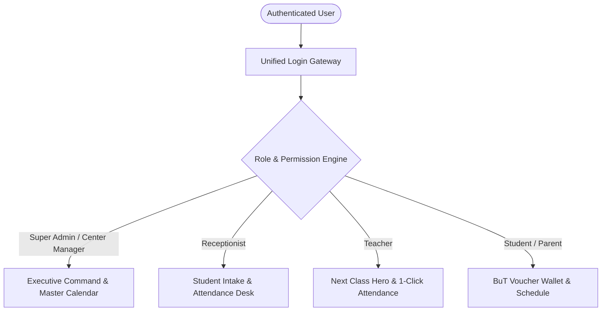

# EduCore ERP / Nachhilfe OS
## Enterprise Resource Planning & Educational Management System Core

[-indigo?style=flat-square)](#architecture)

---

## 1. Executive Summary

**EduCore ERP** is an enterprise-grade cloud management system and modular monolith blueprint engineered specifically for private tutoring academies and educational institutes in Germany (*Nachhilfeinstitute*).

The platform bridges academic management, legal compliance with German social-educational regulations (such as state-sponsored education vouchers **Jobcenter / BuT - Bildung und Teilhabe**), cryptographic payroll sealing for instructors, automated private parent invoicing, and low-latency real-time communications into a unified, high-security ecosystem.

---

## 2. Market Problem & Value Proposition

Traditional tutoring institutes throughout Germany rely on fragmented, disconnected tools (spreadsheets, paper logbooks, unencrypted messaging groups) that result in major compliance, operational, and financial risks:

1. **Jobcenter & BuT Regulatory Compliance**: Stundennachweis certificates require precise timestamped attendance tracking and student-voucher deductions to guarantee caseworkers approve monthly claims without clawbacks.
2. **Scheduling Conflicts & Room Capacity**: Overbooking classroom facilities or scheduling overlapping lessons across individual and group formats violates regional building codes and damages student learning outcomes.
3. **Instructor Wage Integrity & Dispute Prevention**: Tutor payroll calculation with differing hourly rates and lesson classifications requires immutable verification to prevent retroactive payroll tampering.
4. **GDPR / DSGVO Privacy Enforcement**: Strict European and German privacy laws mandate protecting student and parent Personally Identifiable Information (PII) from unauthorized exposure to peer students or unauthorized staff.

**EduCore ERP automates and hardens all these workflows with 100% auditable digital precision.**

---

## 3. The Unified "One App, Role-Driven" Vision

Rather than maintaining separate fragmented apps, EduCore ERP deploys a single, cohesive, role-adaptive client application across Web and Mobile:

- **Single Deployment**: One unified codebase, single PWA/Store package, lower maintenance overhead.
- **Adaptive Ergonomics**: Bottom navigation on mobile, responsive sidebars on desktop/tablet.
- **Context Switcher**: Center managers who also teach can seamlessly toggle between management and instructional views without logging out.

---

## 4. Key Architectural Highlights

### 🏰 Strict Modular Monolith (DDD)
The codebase strictly isolates cross-cutting concerns from business capabilities:
- **`App\Core`**: Shared domain primitives, authentication (Sanctum + Mobile Quick Codes), RBAC (Spatie), Center branding, System logging, Global audit logging, and Notification Center.
- **`App\Modules\Nachhilfe`**: Complete tutoring operations: Subjects, Rooms, Teachers, Students, Packages, BuT Vouchers, Lessons, Schedules, and Messaging.
- **`App\Modules\Billing`**: Invoicing, payment ledger, and financial status tracking.

### ⚡ Transactional Outbox Pattern
Inter-module event publishing uses the transactional `notification_outbox` pattern and background worker (`php artisan outbox:work`) with row-level database locking (`skipLocked()`), ensuring zero event loss even during downstream network partitions.

### 🔒 Cryptographic Payroll Sealing (`Snapshot Hash`)
Approved teacher payroll records generate an immutable SHA-256 digital fingerprint (`snapshot_hash_version: 1`). Any subsequent database tampering of wages, completed hours, or session counts is immediately detected and rejected by the system.

### 🌐 Dual-Layer Real-Time Messaging Engine
- **Primary Transport**: Instant bi-directional push via **Laravel Reverb WebSockets**.
- **Secondary Fallback**: Smart background polling timer (every 3 seconds) with client-side deduplication, guaranteeing 100% sync reliability in restricted corporate or poor mobile data networks.

### 📑 German Regulatory Document Generation
Dynamic PDF generators adhering to official German administrative standards:
1. **Official Stundennachweis PDF**: Legally compliant attendance documentation for municipal Jobcenter and BuT offices.
2. **GDPR-Compliant Room Door Timetable (*Raumbelegungsplan*)**: Classroom door timetable redacting student surnames to comply with European privacy standards.
3. **Teacher Timetable (*Lehrer-Stundenplan*)**: Weekly instructor schedule with assigned rooms, subjects, and student lists.

### 🔐 Blind Indexing & PII Encryption
Personally Identifiable Information (birthdates, phone numbers, home addresses) is encrypted at rest using AES-256 and indexed for high-performance lookup using salted SHA-256 blind indices (`phone_blind_index`).

---

## 5. Security & Verification Baseline

EduCore ERP enforces automated quality and security gates:
- **PHPUnit / Pest Test Suite**: >220 feature and security integration tests.
- **Deptrac Architecture Rules**: Strict enforcement of module boundaries.
- **PHPStan Level 9**: Maximum static analysis typing strictness.
- **Role & Object-Level Authorization**: Dual-layer defense (UI Route Guards + Backend Policies).
