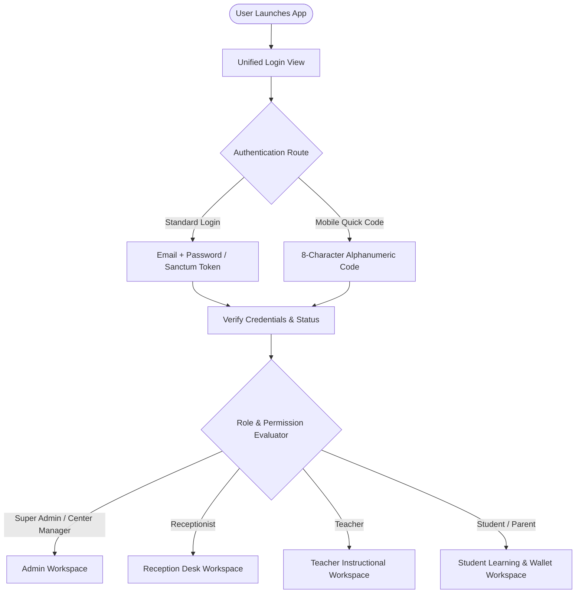
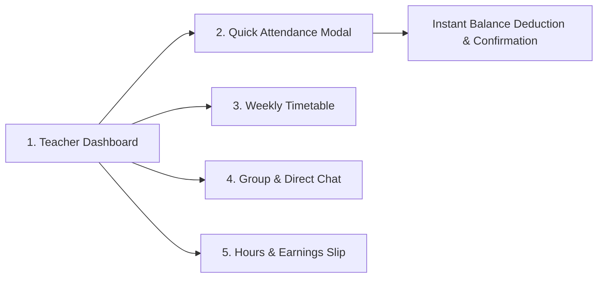
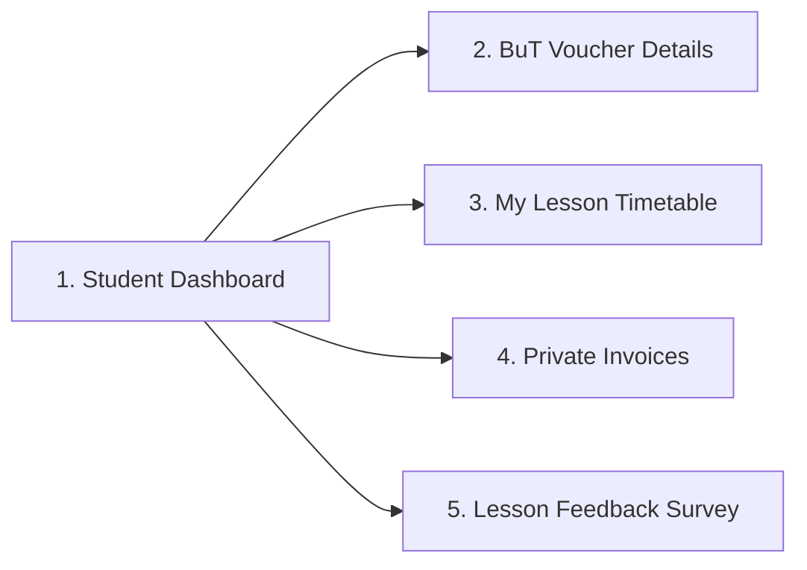
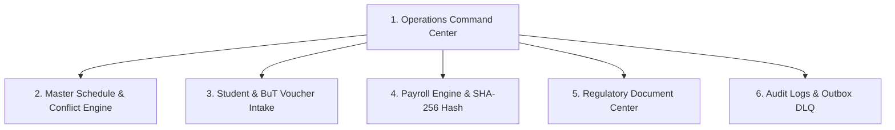

# Unified Application Architecture & User Flow Specification
## One Application, Role-Adaptive UX (Web & Mobile)

---

## 1. Architectural Philosophy: The Adaptive Experience

The system adopts a **Single Unified Client (One Codebase)** approach. Rather than maintaining disparate applications, every user accesses the same application. 

Upon authentication, the **Role Engine** dynamically configures the user experience:
1. **Adaptive Navigation**: Navigation elements (Bottom Tab Bar on mobile, Sidebar on desktop) are composed based on assigned Spatie roles and permissions.
2. **Context-Driven Dashboards**: The landing screen renders role-targeted hero actions (e.g., immediate attendance marking for teachers vs. balance wallets for students).
3. **Data Scoping at Source**: Backend API endpoints enforce domain scoping (teachers only receive their own lessons; students only receive their own invoices).
4. **Seamless Context Switching**: Administrative personnel with teaching duties can switch views instantaneously without signing out.

---

## 2. Global Unified Entry Flow

All users enter through a consolidated authentication gateway:



---

## 3. Role-to-View Visibility & Permissions Matrix

| Feature / Workspace | Admin / Manager | Receptionist | Teacher | Student / Parent |
| :--- | :---: | :---: | :---: | :---: |
| **Executive Dashboard** | Full Operations & Financials | Daily Class & Student Intake | ❌ Hidden | ❌ Hidden |
| **Schedule & Calendar** | Master View (All Rooms/Tutors) | Center-wide Scheduling Desk | **Assigned Classes Only** | **Personal Classes Only** |
| **Attendance Tracking** | Overwrite & Global Audit | Mark for Any Class | **Own Classes Only (1-Click)** | View Personal Status Only |
| **Vouchers & Packages (BuT)** | Full Balance Management | Intake & Voucher Entry | ❌ Hidden | **Own Remaining Hours Card** |
| **Student Contact Info (PII)** | Complete Access | Basic Phone/Emergency Contact | Name & Subject Only (Redacted) | Personal Profile Only |
| **Instructor Payroll** | Calculate, Approve, Seal Hash | ❌ Hidden | **Own Hours & Wage Slip Only** | ❌ Hidden |
| **Invoicing & Payments** | Generate & Track Invoices | Cash Intake / Record Settle | ❌ Hidden | **Own Invoices & Receipts** |
| **Real-time Messaging** | Global Moderation & Surveys | Desk Inquiries | Enrolled Student Groups | Instructor & Center Helpdesk |
| **German Regulatory PDFs** | Stundennachweis, Door Signs | Print Daily Timetables | Personal Timetable Only | ❌ Hidden |
| **System & Audit Logs** | Comprehensive & DLQ Outbox | ❌ Hidden | ❌ Hidden | ❌ Hidden |

---

## 4. Role-Specific User Flows & Screen Specifications

---

### 4.1 Teacher Instructional Flow (Optimized for Mobile In-Classroom Speed)



#### Screen 1: Teacher Dashboard (`/teacher/dashboard`)
* **Hero Widget (Current/Next Class)**: High-contrast card with room number, subject, and time:
  > **Mathematics Grade 9** • Room 02 • 16:00 – 17:30
* **Primary Call-to-Action**: `[⚡ Take Attendance Now]`
* **Weekly Progress Gauge**: Circular progress bar showing completed hours vs. weekly target:
  > *18.5 hrs completed of 25 hrs target*
* **Upcoming Class Timeline**: Quick preview of remaining lessons today.

#### Screen 2: Quick Attendance Modal (`/teacher/lessons/:id/attendance`)
* Clean student card list with immediate 1-tap state toggles:
  * 🟢 **Present**: Triggers automated hourly deduction from student voucher balance.
  * 🟡 **Late**: Dropdown to log delay duration (e.g., 10m, 15m).
  * 🔴 **Absent**: Categorized by Excused / Unexcused.
* Single action button: `[Save Attendance & Complete Lesson]`.

#### Screen 3: Teacher Chat (`/teacher/chat`)
* Channel list scoped strictly to groups and direct chats with currently assigned students.
* File and PDF attachment upload for homework sharing.
* Student private phone numbers remain masked under GDPR rules.

#### Screen 4: Hours & Earnings Wallet (`/teacher/payroll`)
* Monthly breakdown of attended hours, base hourly rate, and approval status (*Pending*, *Approved*, *Cryptographically Sealed*).

---

### 4.2 Student & Parent Flow (Focus on Transparency & Ease of Use)



#### Screen 1: Student Dashboard (`/student/dashboard`)
* **Hours Wallet Card**: Digital card displaying:
  * **Remaining Balance**: e.g., `8.0 Hours Available`.
  * **Voucher Type**: Jobcenter BuT (Bildung und Teilhabe) or Private Package.
  * **Expiration Alert**: Amber banner when balance is `< 2.0 hours` or expiring within 14 days.
* **Next Lesson Card**: Instructor name, subject, classroom, and countdown timer.

#### Screen 2: My Timetable (`/student/schedule`)
* Chronological schedule with past attended dates and upcoming reserved lessons.

#### Screen 3: Invoices & Receipts (`/student/invoices`)
* Listing of private monthly invoices with payment status chips (`Paid`, `Pending`, `Overdue`).
* Direct `[Download Official PDF]` action button.

#### Screen 4: Lesson Feedback Survey (`/student/surveys/:id`)
* Interactive post-lesson feedback widget directly inside the chat feed to rate comprehension (1 to 5 stars) and submit questions to the teacher.

---

### 4.3 Management & Administrative Flow (Operations, Finance & Compliance)



#### Screen 1: Operations Command Center (`/admin/dashboard`)
* **Operational KPI Bar**: Active classes right now, total enrolled students, remaining BuT hours center-wide, overdue invoices.
* **Action Required Drawer**: Expiring vouchers needing renewal, pending payroll approvals, failed outbox messages needing retry.

#### Screen 2: Master Conflict-Free Calendar (`/admin/calendar`)
* Multi-column view organizing schedule by **Room** or **Instructor**.
* Real-time double-booking prevention engine: automated red highlighting when instructor schedule overlaps or room capacity is exceeded.

#### Screen 3: Payroll Engine & Sealing (`/admin/payrolls`)
* Monthly instructor wage table aggregating completed hours and hourly tiers.
* `[Approve & Seal Payroll]` action: calculates and locks the immutable SHA-256 snapshot hash.

#### Screen 4: German Compliance PDF Hub (`/admin/reports`)
* One-click generation of:
  * **Stundennachweis PDF** for municipal Jobcenter submission.
  * **Raumbelegungsplan PDF** for physical classroom doors (GDPR anonymized).
  * **Lehrer-Stundenplan PDF** for weekly staff distribution.

---

## 5. Adaptive Navigation Specifications

### 5.1 Mobile / Tablet Navigation (Dynamic Bottom Bar)

The bottom navigation bar automatically restructures based on the authenticated user's role:

```text
[Teacher Bottom Bar]
┌──────────────┬──────────────┬──────────────┬──────────────┬──────────────┐
│   Home 🏠    │  Schedule 📅 │ Attendance ✅│    Chat 💬   │  Wallet 💼   │
└──────────────┴──────────────┴──────────────┴──────────────┴──────────────┘

[Student Bottom Bar]
┌──────────────┬──────────────┬──────────────┬──────────────┬──────────────┐
│   Home 🏠    │  Vouchers 💳 │  Timetable 📅│    Chat 💬   │ Invoices 🧾  │
└──────────────┴──────────────┴──────────────┴──────────────┴──────────────┘

[Admin Bottom Bar]
┌──────────────┬──────────────┬──────────────┬──────────────┬──────────────┐
│ Operations 📊│  Calendar 📅 │  Students 👥 │  Payrolls 💰 │   More ⚙️    │
└──────────────┴──────────────┴──────────────┴──────────────┴──────────────┘
```

### 5.2 Desktop Navigation (Adaptive Responsive Sidebar)
* Expanded persistent sidebar providing comprehensive administrative modules for Managers, but automatically collapsing to streamlined options for instructors and students.

### 5.3 Instant Context Switcher (Dual-Role User Support)
* Users holding both administrative and instructional roles (e.g., Center Manager teaching Mathematics) can toggle workspaces instantly via the top app bar without logging out:
  > `[Switch to Teacher Workspace 👨‍🏫] ↔ [Return to Admin ERP 🏢]`
